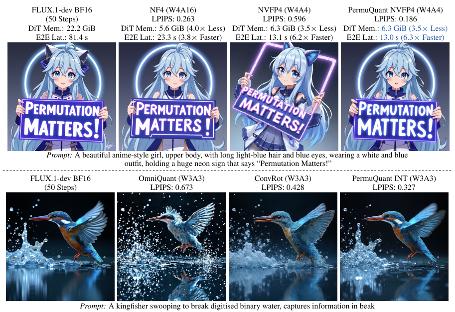
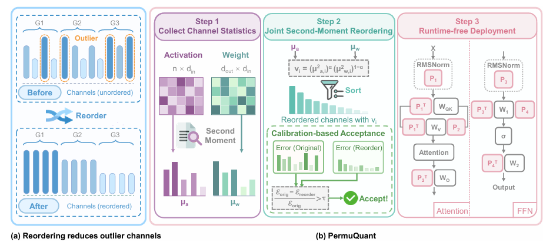
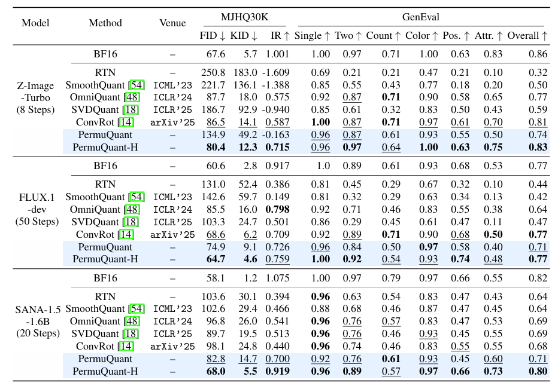
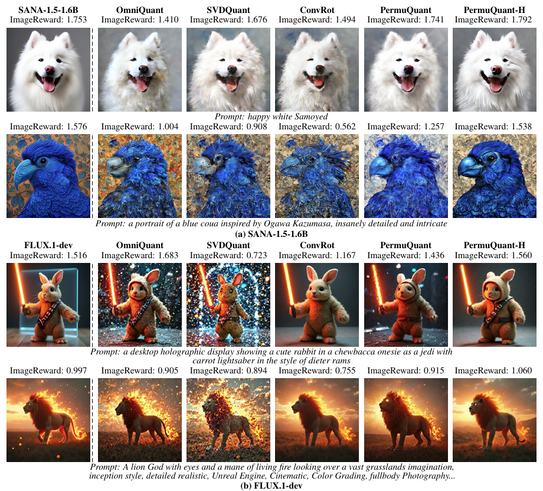

# PermuQuant: Lowering Per-Group Quantization Error by Reordering Channels for Diffusion Models
Yongsen Cheng, [Kai Liu](https://kai-liu.cn/), Kaiwen Tao, Junxian Li, Zhixin Wang, Zhikai Chen, Renjing Pei, [Yulun Zhang](http://yulunzhang.com/)

[](https://arxiv.org/abs/2605.09503)

#### 🔥🔥🔥 News

- **2026-09-25:** PermuQuant is accepted by NeurIPS 2026!!!
- **2026-05-09:** This repo is released.

---



> **Abstract:** Large-scale visual generative models have achieved remarkable performance. However, their high computational and memory costs make deployment challenging in resource-constrained scenarios, such as interactive applications and personal single-GPU usage. Post-training quantization (PTQ) offers a practical solution by compressing pretrained models without expensive retraining. However, existing PTQ methods still suffer from severe quality degradation under extremely low-bit settings. In this paper, we identify channel ordering as an important but underexplored factor in per-group quantization. In this setting, each contiguous group shares one quantization scale. When channels with very different statistics are placed in the same group, the scale can be dominated by outliers and cause large quantization errors. Based on this observation, we propose PermuQuant, a simple and effective PTQ framework for low-bit diffusion models. PermuQuant sorts channels by a joint second-moment criterion before per-group quantization, placing channels with similar activation and weight statistics into the same group. It further uses a calibration-based acceptance rule to apply reordering only when the selected permutation reduces quantization error on calibration data. The selected permutations are absorbed into adjacent modules or applied to weights offline, avoiding explicit runtime permutation operations. Extensive experiments on multiple large diffusion models show that PermuQuant consistently reduces quantization error and outperforms existing PTQ baselines. On FLUX.1-dev with an NVIDIA RTX 5090, PermuQuant achieves up to a 1.8$\times$ single step speedup and reduces the DiT memory footprint by 3.5$\times$ under W4A4 NVFP4 quantization.

## ⚒️ TODO

* [√] Release code

## 🔎 Method Overview



## <a name="results"></a>🔎 Results

<summary>Quantitative Results</summary>

<p align="center">
  
</p>


<summary>Qualitative Results on W3A3</summary>

<p align="center">
  
</p>
## <a name="citation"></a>📎 Citation

If you find our work helpful in your research or work, please cite our work.

```
@inproceedings{Cheng2026permuquant,
    title={PermuQuant: Lowering Per-Group Quantization Error by Reordering Channels for Diffusion Models},
    author={Cheng, Yongsen and Liu, Kai and Tao, Kaiwen and Li, Junxian and Wang, Zhixin and Chen, Zhikai and Pei, Renjing and Zhang, Yulun},
    journal={arXiv preprint arXiv:2605.09503},
    year={2026}
}
```


# Reproduction

The implementations are organized independently by model.

| Model | Table 1 setup | Instructions |
|---|---|---|
| Z-Image-Turbo | W3A3, G32, 8 steps | [Z-Image](Z-Image/README.md) |
| FLUX.1-dev | W3A3, G64, 50 steps | [FLUX](flux/README.md) |
| Sana-1.5 1.6B | W3A3, G32, 20 steps | [Sana](Sana/README.md) |

## Environment setup

All three models share one inference environment (`permuquant`) and one evaluation environment (`permuquant-eval`). Run installation commands from the repository root.

```bash
conda create -n permuquant python=3.10 -y
conda activate permuquant
pip install torch==2.8.0 torchvision==0.23.0 torchaudio==2.8.0 --index-url https://download.pytorch.org/whl/cu128
pip install -r requirements-runtime.txt
pip install xformers==0.0.32.post2 --no-deps
pip install -e ./flux --no-deps
pip install -e ./Z-Image --no-deps
```

For RTX 5090 with xformers 0.0.32.post2, run `python flux/fake_quant/cli/configure_xformers.py` after installation to select FA2/CUTLASS instead of the incompatible Hopper FA3 default. Rerun after reinstalling xformers.

```bash
conda create -n permuquant-eval python=3.10 -y
conda activate permuquant-eval
pip install torch==2.8.0 torchvision==0.23.0 torchaudio==2.8.0 --index-url https://download.pytorch.org/whl/cu128
pip install -r requirements-eval.txt
# Build/install mmcv-full==1.7.2 with CUDA support for your GPU first.
pip install -e ./third_party/mmdetection --no-deps
python -c "from mmcv.ops import nms"
```

MMCV requires a GPU-compatible build; the commands above do not automate this CUDA build. Do not install the inference environment's `mmcv` package over `mmcv-full` in the evaluation environment.

### Evaluation assets

Download the [MJHQ-30K reference dataset](https://huggingface.co/datasets/playgroundai/MJHQ-30K) and evaluation model weights before running evaluation. Execute these commands from a model directory (`flux/`, `Sana/`, or `Z-Image/`), using the inference environment's Hugging Face CLI:

```bash
conda activate permuquant

# MJHQ-30K reference images and metadata
hf download playgroundai/MJHQ-30K mjhq30k_imgs.zip meta_data.json \
  --repo-type dataset --local-dir eval/MJHQ-30k/data
unzip -q eval/MJHQ-30k/data/mjhq30k_imgs.zip -d eval/MJHQ-30k/data

# GenEval Mask2Former detector
bash eval/geneval/evaluation/download_models.sh eval/geneval/model

# ImageReward weights and configuration
hf download zai-org/ImageReward ImageReward.pt med_config.json \
  --local-dir checkpoints/metrics/ImageReward

# ImageReward's BERT tokenizer (cached for offline loading)
hf download bert-base-uncased \
  --include vocab.txt tokenizer.json tokenizer_config.json config.json \
  --cache-dir cache/huggingface/hub

# CLIP weights used by GenEval
mkdir -p checkpoints/metrics
curl -fL --retry 3 \
  https://openaipublic.azureedge.net/clip/models/b8cca3fd41ae0c99ba7e8951adf17d267cdb84cd88be6f7c2e0eca1737a03836/ViT-L-14.pt \
  -o checkpoints/metrics/ViT-L-14.pt

# Inception weights used by FID/KID
mkdir -p cache/torch/hub/checkpoints
curl -fL --retry 3 \
  https://github.com/toshas/torch-fidelity/releases/download/v0.2.0/weights-inception-2015-12-05-6726825d.pth \
  -o cache/torch/hub/checkpoints/weights-inception-2015-12-05-6726825d.pth
```

The directory layout under each model should be:

```text
<model>/                              # flux/, Sana/, or Z-Image/
├── eval/
│   ├── MJHQ-30k/data/
│   │   ├── meta_data.json
│   │   ├── animals/
│   │   ├── ...                       # Category folders containing <image_id>.jpg
│   │   └── vehicles/
│   └── geneval/model/
│       └── mask2former_swin-s-p4-w7-224_lsj_8x2_50e_coco.pth
├── checkpoints/metrics/
│   ├── ImageReward/
│   │   ├── ImageReward.pt
│   │   └── med_config.json
│   └── ViT-L-14.pt
└── cache/
    ├── huggingface/hub/
    │   └── models--bert-base-uncased/
    └── torch/hub/checkpoints/
        └── weights-inception-2015-12-05-6726825d.pth
```

These directories may link to one shared local copy instead of downloading the assets three times. The detector configuration is provided by `third_party/mmdetection`.

## License

Original PermuQuant contributions in this repository are licensed under the [Apache License 2.0](LICENSE). Third-party code retains its existing copyright notices and license terms; see the license files in `Z-Image/`, `flux/`, `Sana/`, and `third_party/mmdetection/` and any file-level notices. Model weights and datasets are subject to their respective licenses and are not covered by this repository's code license.
